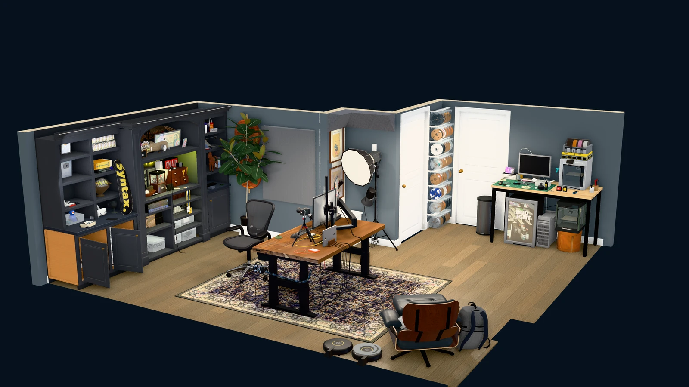

I scanned my office with my iPhone, then used Codex to rebuild it in Three.js. My desk, the shelves, the 3D printers, the wall of filament rolls. All editable geometry, running in a browser.

Then, naturally, I added physics so I could throw everything around. And a Nintendo Zapper.

**[Explore my office](https://wesbos.github.io/3d-model-anything/) · [Get the code on GitHub](https://github.com/wesbos/3d-model-anything)**

## The scan is the starting point

The iPhone doesn't spit out this finished model. It gives us a few different kinds of evidence:

- **RoomPlan** identifies walls, doors, windows and rough furniture boxes. Great for the layout; pretty basic to look at.
- **LiDAR** captures a mesh of the surfaces around you. It helps with shape and dimensions, but small objects and fine details need more work.
- **Photos** show the stuff the geometry misses: materials, labels, cables, shelf contents and all the little details that make it look like my office.
- **Camera poses and depth frames** tell us where the phone was, which way it was looking, and how far away surfaces were.

The important bit: the photos aren't just a folder of unrelated images. Each one has a recorded camera position, orientation and camera calibration. We can use that to render the 3D scene from the same viewpoint and compare the two side by side.

## Build, screenshot, compare, repeat

The agent uses the measurements to build the room, then works through the furniture and smaller objects. It opens the viewer, takes screenshots, compares them with the reference photos, and changes the code.

Is the desk too wide? Is that shelf in the wrong place? Does the chair actually look like my chair? Those comparisons give it something concrete to work on.

This took a lot of iteration. Getting the layout right is one pass. Getting the materials, lighting, shadows and tiny details right is a whole other job. It's not a one-click conversion, and the measurements are still worth checking against the real thing.

Because the result is Three.js code, we can do more than look at it. Switch to wireframe, walk around, lay the objects out in a knolling view, or turn the room into a ridiculous physics playground.

## Try it with your own room

I've published the project as **3D Model Anything**. It includes:

- The iPhone app source for capturing room layouts, meshes, photos and depth.
- The `scan-to-threejs` agent skill with the workflow and conversion/comparison tools.
- The browser viewer and my office as a worked example.

Scanning requires a LiDAR-equipped iPhone or iPad. The app source is available to build with Xcode; an App Store release is a separate step.

Export a room from the app, open the repo in your coding agent, and ask it to use the `scan-to-threejs` skill with that capture. The README covers setup and the helper dependencies.

**[Grab 3D Model Anything on GitHub →](https://github.com/wesbos/3d-model-anything)**
